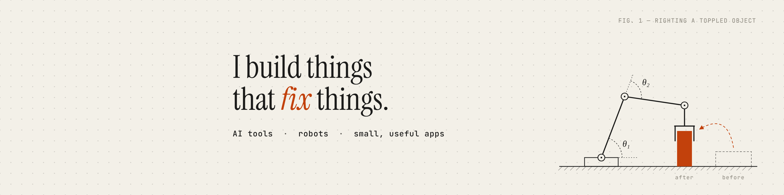

### Hi, I'm Jayanth 👋

I like finding a problem that bugs someone and building the thing that fixes it.

**Some things I've built**

- **[Dual-arm mobile manipulator](https://github.com/JayanthMalladi/btp-kobuko-dual-arm)**: a two-armed robot that picks up knocked-over objects and stands them back upright. My B.Tech project, built in ROS 2 and Gazebo.
- **[Saathi 1930](https://github.com/JayanthMalladi/saathi-1930)**: a Hinglish voice helpline that walks UPI fraud victims through filing a complaint. Work in progress for the Bolna buildathon.
- **[cat-buddy](https://github.com/JayanthMalladi/cat-buddy)**: a desktop cat for macOS that keeps to-dos and reminders, built in a week around one person's feedback.
- **[AutoManim AI](https://github.com/JayanthMalladi/automanim)**: a web app that turns plain English into math animations.

Last summer I was a Summer Analyst at Goldman Sachs, building an AI document tool for Private Banking. Before that, robot digital twins at Quest Global and GenAI workshops for 200+ students as GDG lead.

Mechanical Engineering at IIT Patna, class of 2027 · Codeforces Specialist

**Tools I reach for:** Python · TypeScript · React · Kotlin · AWS · LLMs · ROS 2 · Swift

If you're building something interesting, I'd love to hear about it: [jayanthmalladi1@gmail.com](mailto:jayanthmalladi1@gmail.com) · [LinkedIn](https://www.linkedin.com/in/jayanthmalladi/) · [jayanthmalladi.vercel.app](https://jayanthmalladi.vercel.app)
