# Jayanth Malladi

> mechanical engineer · software builder · AI where it matters



I build AI that runs in places where mistakes cost money — **bank documents, fraud hotlines, robot hands.** Most of it starts as a problem I hit in my own day, then I find out who else needs it.

---

## ▸ contribution heat · last 52 weeks

```
Dec  Jan  Feb  Mar  Apr  May  Jun  Jul  Aug  Sep  Oct
                                                ..o:.
                                              . .. o
                 .                              .:o@
                 .                         .      :.
                                        .         @.
         .                          .   .   .  :.:o.
                                           .    . o:.
```

`35 active days · busiest 2026-11-02 · longest streak 13d`

---

## ▸ featured — Shim

```
$ npx getshim scan ./your-repo
  › breaking API change detected
  › applied 1 deterministic fix, gated on baseline
  › opened 1 reviewed PR          (no human in the loop)

An upgrade agent: when a dependency's API changes, Shim scans your code,
fixes it deterministically, and opens a single tested PR.
```

`19 upgrade-PRs open right now, across the AI-SDK ecosystem → [shim](https://github.com/JayanthMalladi/shim) · [getshim.dev](https://getshim.dev)`

---

## ▸ around the web

`[github](https://github.com/JayanthMalladi)` · `[linkedin](https://linkedin.com/in/jayanthmalladi)` · `[codeforces · Specialist 1400+](https://codeforces.com/profile/jay.malladi)` · `[resume](https://github.com/JayanthMalladi/portfolio/raw/main/public/Jayanth_Malladi.pdf)`
