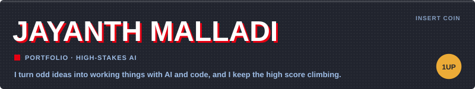
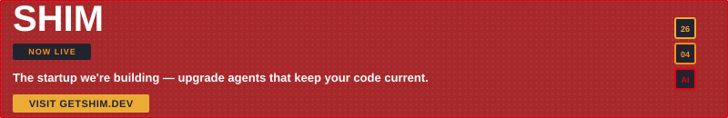
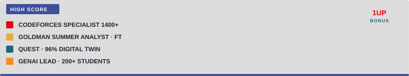

  

  

  

<!-- Live streak (your existing widget — kept). Renders on GitHub's native graph theme. -->

  

<!-- Around the web: one horizontal row of compact clickable shields badges
     (SVGs served as  can't carry links, so these are what open on GitHub): -->

  
  
  
  

